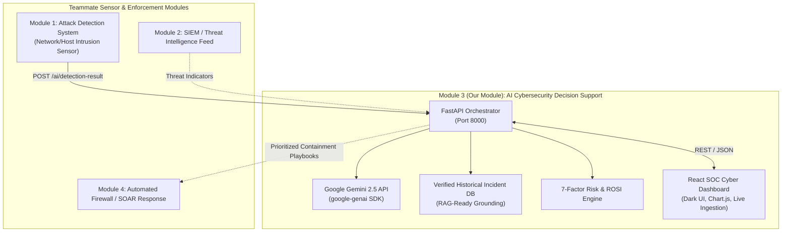

# CyberQuant AI — Cybersecurity Decision-Support Assistant
> **Enterprise Cyber Defense Intelligence & Decision Support Platform**  
> An AI-powered cyber defense intelligence platform that explains detected attacks, evaluates multi-factor organizational risk, references verified historical incidents, models projected financial downtime, calculates cybersecurity budget allocation, and provides automated decision support.

---

## 1. System Architecture & Team Integration

Our platform brings together 4 specialized team modules into a cohesive cyber defense pipeline:



---

## 2. Key Capabilities

### A. Conversational AI Security Chatbot (`POST /ai/chat`)
- Contextual multi-turn dialogue with memory.
- Dynamic **Simple Language Mode** for non-technical leadership and beginners.
- Proactive follow-up question recommendation pills.
- Grounded citations linking directly to verified public breaches.

### B. Deep Attack Intelligence (`POST /ai/explain`)
- Complete structural breakdown for:
  - **Ransomware**
  - **Phishing**
  - **DDoS**
  - **SQL Injection**
  - **Cross-Site Scripting (XSS)**
  - **Malware**
  - **Man-in-the-Middle (MitM)**
  - **Zero-day attacks**
  - **Password attacks**
- Detailed lifecycle, vulnerabilities exploited, affected assets, consequences, and why it is dangerous.

### C. Zero-Hallucination Historical Incidents
Curated, verified real-world incidents with official government/regulatory citations:
- **Colonial Pipeline (2021)**: DarkSide ransomware, $4.4M ransom verified via US Senate testimony.
- **UK NHS WannaCry (2017)**: MS17-010 EternalBlue worm, £92M verified by UK National Audit Office.
- **A.P. Moller - Maersk (2017)**: NotPetya supply chain wiper, $300M loss reported in SEC/annual reports.
- **Dyn DNS (2016)**: Mirai IoT botnet 1.2 Tbps DDoS outage across Twitter, Spotify, and GitHub.
- **Equifax (2017)**: Apache Struts zero-day, 147M records, $1.38B FTC settlement.
- **Heartland Payment Systems (2008)**: SQL injection, 130M cards, $140M loss.
- **British Airways (2018)**: Magecart digital skimming / XSS, £20M ICO GDPR penalty.
- **23andMe (2023)**: Credential stuffing password attack, 6.9M accounts affected, $30M settlement.

### D. Transparent 7-Factor Risk Assessment (`POST /ai/analyze`)
Calculates objective organizational risk (0–100) separating **sensor detection confidence** from **enterprise risk**:
- Likelihood (1–5)
- Financial Impact Scale (1–5)
- Operational Mission Disruption (1–5)
- Data Sensitivity (Public, Internal, Confidential, Restricted, PII/PHI)
- Organization Size (Small, Medium, Large, Enterprise)
- Industry Sector Multiplier (Healthcare, Finance, Critical Infrastructure, Retail, Tech)
- Active Security Controls (MFA, EDR, Backups, SIEM, WAF, Training)

### E. Financial Downtime & Loss Projections
Distinguishes historical losses from projected future losses across:
1. Operational Downtime & Business Interruption
2. Data Recovery & Digital Forensics Retainers
3. Legal Counsel & Breach Notifications
4. Regulatory Penalties (DPDP, GDPR, HIPAA)
5. Customer Churn & Reputation Devaluation

### F. Cybersecurity Budget Allocation & ROSI Planner (`POST /ai/budget`)
- Resource optimization based on organization type, size, annual budget, and primary threat.
- Quantitative Return on Security Investment:
  $$\text{ROSI} = \frac{(\text{ALE}_{\text{prior}} - \text{ALE}_{\text{post}}) - \text{Cost}}{\text{Cost}} \times 100\%$$
- Explains assumptions, limitations, and expected risk reduction percentages.

### G. Teammate Attack Detection Integration (`POST /ai/detection-result`)
- Receives live detection events from your teammate's sensor module:
  ```json
  {
    "attack_type": "Ransomware",
    "severity": "Critical",
    "confidence": 94,
    "source": "Network Detection Module"
  }
  ```
- Instantly returns an incident briefing, immediate 4-step containment playbook (with timelines and role owners), projected downtime, and historical benchmarks.

---

## 3. Installation & Local Setup

### Prerequisites
- Python 3.10+ (Recommended: Python 3.11 or Python 3.13)
- Modern web browser (Chrome, Edge, Firefox, Brave)

### Step 1: Clone or Navigate to Project
```bash
cd "C:\ROHAN\CyberQuant AI"
```

### Step 2: Install Backend Dependencies
```bash
# Using your Python installation or active virtual environment:
pip install -r requirements.txt
```

### Step 3: Configure Environment Variables
Create or verify your `.env` file in the project root:
```env
# Google Gemini API Key
GEMINI_API_KEY=your_actual_gemini_api_key_here

# Server Settings
HOST=0.0.0.0
PORT=8000
ENVIRONMENT=development
```
> *Note: If no Gemini API key is configured or rate limits are reached, the system automatically runs in high-fidelity domain knowledge fallback mode without throwing runtime errors.*

### Step 4: Run the Application
You can run the application either directly through Python or via Uvicorn:
```bash
# Option A: Directly with Python
python main.py

# Option B: With Uvicorn reload
uvicorn main:app --reload --host 0.0.0.0 --port 8000
```

### Step 5: Open the Interactive Cyber Dashboard
Once started, open your web browser to:
- **Interactive SOC Dashboard**: `http://localhost:8000/dashboard`
- **Interactive Swagger API Documentation**: `http://localhost:8000/docs`
- **Root Health Check**: `http://localhost:8000/health`

---

## 4. Teammate API Integration Guide

Teammates developing the **Attack Detection Module** can post alert events directly to your endpoint from Python, Node.js, or curl:

### Python Example for Teammate Module:
```python
import requests

payload = {
    "attack_type": "Ransomware",
    "severity": "Critical",
    "confidence": 94.0,
    "source": "Network Detection Module"
}

response = requests.post("http://127.0.0.1:8000/ai/detection-result", json=payload)
data = response.json()

print(f"Risk Level: {data['risk_level']} (Score: {data['organizational_risk_score']})")
print("Immediate Action Required:")
for step in data['immediate_containment_playbook']:
    print(f"[{step['timeline']}] {step['action']} (Owner: {step['owner']})")
```

### cURL Example:
```bash
curl -X POST http://127.0.0.1:8000/ai/detection-result \
  -H "Content-Type: application/json" \
  -d '{"attack_type": "Ransomware", "severity": "Critical", "confidence": 94, "source": "Network Detection Module"}'
```

---

## 5. Directory Structure

```
CyberQuant AI/
├── .env                             # Environment configuration (GEMINI_API_KEY)
├── .env.example                     # Environment template for team
├── .gitignore                       # Protects credentials and virtualenvs
├── requirements.txt                 # Backend dependencies
├── main.py                          # Unified launch entry point & backward compatibility
├── README.md                        # Documentation & setup guide
│
├── backend/
│   └── app/
│       ├── main.py                  # FastAPI core app & CORS configuration
│       ├── config.py                # Environment and settings manager
│       ├── schemas/                 # Strict Pydantic v2 validation models
│       │   ├── chat.py              # ChatRequest, ChatResponse, History
│       │   ├── attack.py            # AttackRequest, AttackExplainResponse
│       │   ├── risk.py              # RiskAssessmentRequest, RiskAssessmentResponse
│       │   ├── budget.py            # BudgetAllocationRequest, BudgetAllocationResponse
│       │   └── detection.py         # DetectionResultInput, DetectionAnalysisResponse
│       ├── services/                # Isolated core business & AI engines
│       │   ├── gemini_service.py    # Google GenAI SDK wrapper + fallback logic
│       │   ├── incident_service.py  # Verified historical incident repository (RAG-ready)
│       │   ├── risk_service.py      # Transparent 7-factor risk scoring engine
│       │   └── budget_service.py    # Quantitative ROSI & budget allocation optimizer
│       ├── routers/                 # Clean API endpoint routers
│       │   ├── ai_chat.py           # POST /ai/chat
│       │   ├── ai_explain.py        # POST /ai/explain
│       │   ├── ai_analyze.py        # POST /ai/analyze
│       │   ├── ai_budget.py         # POST /ai/budget
│       │   └── detection.py         # POST /ai/detection-result
│       └── data/
│           └── historical_incidents.json  # Curated real-world incident dataset
│
└── frontend/                        # Frontend Architecture
    ├── static_dashboard.html        # Zero-install standalone React SOC Dashboard
    ├── package.json                 # Optional Vite/React package build setup
    └── src/                         # Reusable React components & API client
        └── services/
            └── api.js               # Clean fetch client for teammates
```

---

## 6. Key Platform Evaluation Highlights
1. **Explainability**: Complex cyber threats are decomposed into intuitive steps with a toggleable Simple Language Mode for non-technical stakeholders.
2. **Scientific Transparency**: Risk and budget formulas are fully exposed with clear assumptions, eliminating black-box outputs.
3. **Evidence-Based Grounding**: References verified historical breaches and regulatory penalty precedents rather than fabricated numbers.
4. **Seamless Integration**: Ready out-of-the-box for input from teammate detection sensors.
